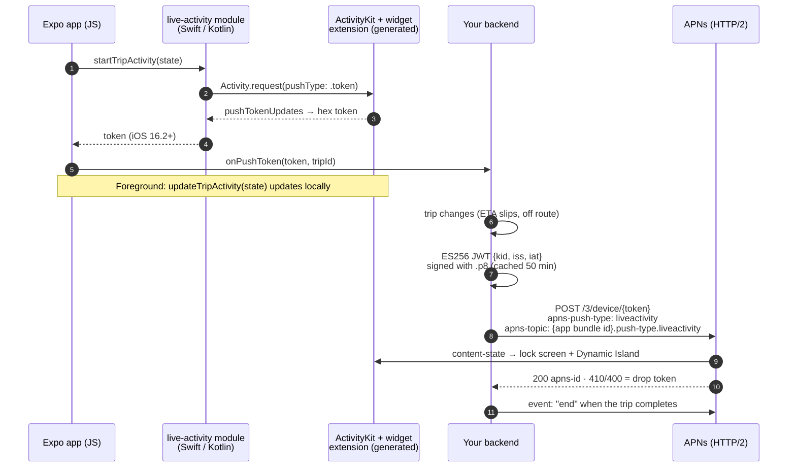

# expo-live-activity

iOS Live Activities (lock screen + Dynamic Island) from an Expo app with zero
manual Xcode steps: a config plugin that generates the WidgetKit extension at
prebuild, a small native module to start/update/end it (with an Android
ongoing-notification fallback), and a dependency-free Node sender for APNs
ActivityKit pushes.

## Why this exists

A Live Activity needs a WidgetKit **app extension target**: its own Swift
sources, Info.plist, bundle id, build settings, a target dependency, and a copy
phase that embeds the `.appex` into the app. In a bare React Native app you add
that once in Xcode. In an Expo app the `ios/` folder is generated and thrown
away by every `expo prebuild --clean`, so a hand-made target disappears on the
next build. This was extracted from the driver app of a production trucking
operations platform, where the active trip (next stop, ETA, drive time left,
break due, off-route) lives on the lock screen and is pushed from the server
while the phone is in the driver's pocket.

## What the plugin generates

`plugin/withTripLiveActivity.js` runs during `expo prebuild` and makes four
changes, every one idempotent:

| Mod | Result |
| --- | --- |
| `withDangerousMod` (ios) | Writes `ios/TripLiveActivity/`: `Info.plist` (`com.apple.widgetkit-extension`), `TripActivityAttributes.swift`, `TripLiveActivityBundle.swift`, `TripLiveActivityWidget.swift` (lock-screen view + Dynamic Island compact / minimal / expanded regions). |
| `withXcodeProject` | Adds the `TripLiveActivity` app-extension target with Sources/Frameworks/Resources phases and the three Swift files; sets bundle id `<app bundle id>.TripLiveActivity`, iOS 16.1, Swift 5, `SKIP_INSTALL`, optional `DEVELOPMENT_TEAM`; adds an app → extension **target dependency**; embeds `TripLiveActivity.appex` in a PlugIns copy phase (`dstSubfolderSpec = 13`), creating one if needed. Re-running finds the existing target and repairs settings instead of duplicating. |
| `withInfoPlist` | Sets `NSSupportsLiveActivities = true` on the host app (ActivityKit refuses `Activity.request()` without it). |
| config | Adds `extra.eas.build.experimental.ios.appExtensions` so EAS Build provisions a profile for the extension. |

```json
{ "expo": { "ios": { "bundleIdentifier": "com.example.tripactivity" },
            "plugins": ["expo-live-activity-plugin"] } }
```

Options: `["expo-live-activity-plugin", { "bundleIdentifier": "…", "appleTeamId": "…" }]`.

## Architecture



Key decisions:

- **The plugin owns everything Xcode would.** Including the parts that are easy
  to forget and fail silently: the Info.plist opt-in, the target dependency, the
  embed phase, and the EAS extension entry. No step in the setup below opens
  Xcode.
- **One `ContentState`, three places.** The extension's Swift struct, the native
  module's private copy of it, and the server's JSON must agree exactly —
  ActivityKit matches by type name and Codable shape, and a mismatch means
  `Activity.request` succeeds but the widget never renders. A test asserts all
  three are identical.
- **Strings in, strings out.** The activity shows pre-formatted text
  (`"ETA 4:12 PM"`, `"Break in 1h 05m"`). No formatting or business logic runs
  in the widget, which is memory-capped and cannot call back into JS; the same
  strings drive the Android notification.
- **Never crash the host app.** The JS wrapper loads the native module lazily
  with `requireOptionalNativeModule`; in Expo Go, on Android without the
  module, or with Live Activities disabled, every call is a no-op and
  `isLiveActivityAvailable()` is `false`.
- **Server: no SDK, no framework.** `server/apns-live-activity.ts` signs the
  ES256 provider token with WebCrypto (which already emits the raw `r‖s`
  signature JWS wants), reads `APNS_*` from the environment, talks HTTP/2 via
  `node:http2` (APNs does not speak HTTP/1.1, which is what Node's global
  `fetch` negotiates), and returns `{ ok, terminal }` rather than throwing so a
  410 can delete the stored token.

## Repository layout

```
plugin/    Expo config plugin (CommonJS, runs in Node at prebuild)
module/    Expo module "live-activity": Swift (ActivityKit), Kotlin (ongoing
           notification), TS wrapper + useTripLiveActivity() hook
server/    apns-live-activity.ts (sender) + cli.ts (one-off push / dry run)
example/   Minimal Expo app: Start trip / Update ETA / Next stop / End trip
tests/     Plugin against Expo's real template Xcode project; APNs sender
```

## Setup

Prerequisites: Node 20+, pnpm, and for running on a phone a Mac with Xcode 15+,
an Apple Developer account and an iPhone on iOS 16.2+ (Live Activities do not
render in Expo Go; the simulator can display them, but test pushes on a device).

```bash
pnpm install
pnpm test                 # plugin + APNs tests, runs anywhere
pnpm typecheck            # server, module, tests

cd example
npx expo prebuild --platform ios --clean   # generates ios/ incl. TripLiveActivity target
npx expo run:ios --device                  # build a dev client onto your iPhone
```

Tap **Start trip** — the activity appears on the lock screen and in the
Dynamic Island, and the app shows its APNs push token. **Update ETA** and
**Next stop** update it locally; **End trip** dismisses it.

Push an update from the server side while the app is backgrounded:

```bash
cp .env.example .env      # fill APNS_TEAM_ID, APNS_KEY_ID, APNS_PRIVATE_KEY
set -a; . ./.env; set +a
pnpm push -- --token <token from the app> --stop "Delivery — Example Co" --eta-minutes 30
pnpm push -- --token <token> --end
```

Without credentials, `pnpm push` prints the exact request it would send. Dev
builds receive pushes from the **sandbox** host; set
`APNS_ENVIRONMENT=production` for TestFlight / App Store builds.

In your own app: copy `plugin/` and `module/` in (or add them as workspace
packages), add the plugin to `app.json`, call `useTripLiveActivity(active,
state, onPushToken)` from your trip screen, and call
`sendApnsLiveActivityUpdate()` from wherever your backend learns the trip
changed.

## Tests

```bash
pnpm test
```

iOS cannot be built on Linux CI, so the tests prove everything short of
`xcodebuild`:

- `tests/plugin.test.ts` — runs the plugin against the **actual** Xcode project
  Expo SDK 54's prebuild starts from (`tests/fixtures/ios-template`, verbatim
  from `expo-template-bare-minimum`): extension target and product type, build
  settings for Debug and Release, Swift files in the Sources phase, app → extension
  target dependency, `.appex` embedded in PlugIns, idempotency (a second run
  writes a byte-identical project), pbxproj round-trip, the full plugin through
  Expo's own `compileModsAsync` (files on disk, Info.plist flag, EAS entry),
  and `ContentState` parity across extension, module and server.
- `tests/apns.test.ts` — a generated P-256 key stands in for the `.p8`; the JWT
  is verified with Node's crypto (and rejected under a different key); token
  caching and re-minting; env parsing incl. one-line PEMs; headers, URL and
  payload for update and end events; terminal vs retryable failures; and the
  real `node:http2` transport against a local HTTP/2 server.

CI additionally runs a real `expo prebuild --platform ios` on the example app
and greps the generated project.

The tests found one production bug, fixed here: on a fresh single-target Expo
project the `xcode` library has no `PBXTargetDependency` section, and its
`addTargetDependency` silently does nothing in that case — so the app → extension
dependency was never written. The plugin now creates the sections first.

## What was left out

The product glue: the backend mutation that stores push tokens per driver and
device, the notification router that decides when a trip change is worth a
push, the hours-of-service and routing logic that produce the strings, auth,
and the app's other config plugins. The generated widget UI is the production
one, unchanged.

## License

MIT
